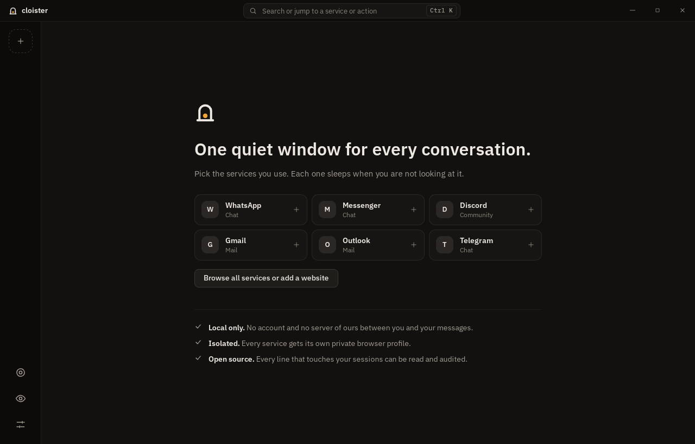
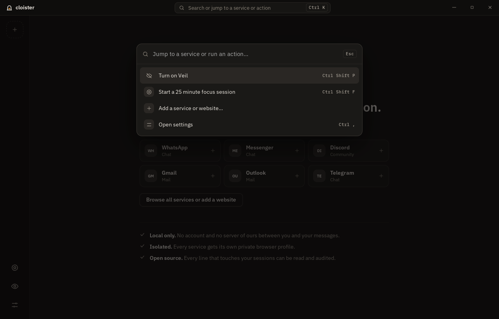
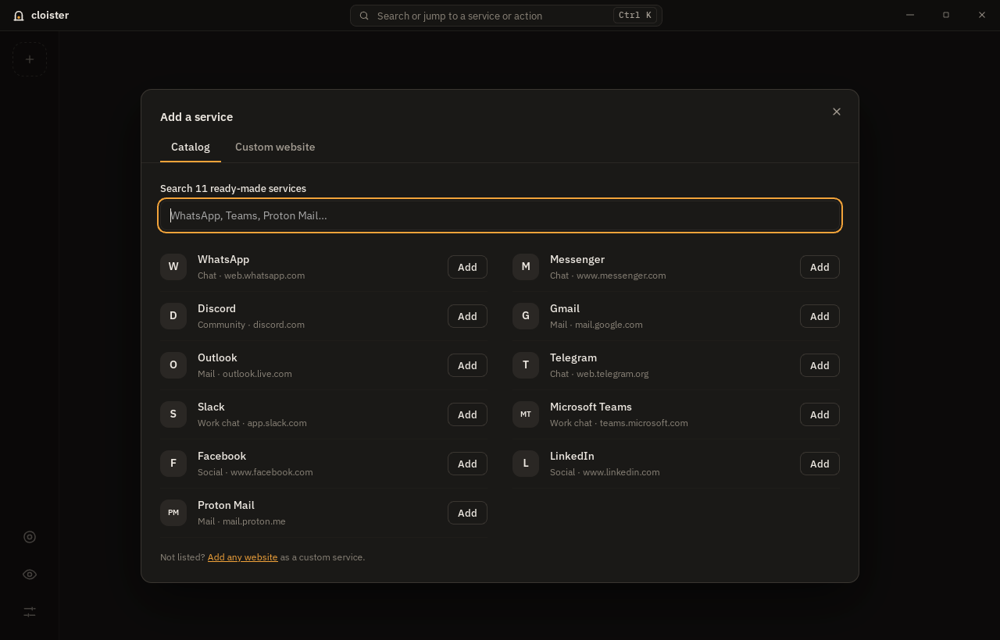

<p align="center">
  
</p>

<h1 align="center">Cloister</h1>

<p align="center">
  A quiet, private, lightweight home for your messaging apps.<br>
  WhatsApp, Discord, Gmail, Messenger and any website, in one window, built with Rust and Tauri.<br>
  <sub>Designed and built by Muntahi Safwan</sub>
</p>

<p align="center">
  <a href="https://muntahi-safwan.github.io/Cloister/"><b>Website</b></a> ·
  <a href="https://github.com/Muntahi-Safwan/Cloister/releases/latest"><b>Download</b></a> ·
  <a href="#install">Install guide</a>
</p>

<p align="center">
  
</p>

## Why Cloister

Most all-in-one messengers ship a full copy of Chromium and keep every service awake. Cloister uses the
browser engine that is already on your computer (WebView2 on Windows, WebKit on macOS and Linux), loads a service only when you open
it, and can put idle services to sleep. Privacy is a first-class feature rather than a setting buried in a menu.

- **One window, many services.** Built-in recipes for WhatsApp, Messenger, Discord, Gmail, Outlook, Telegram,
  Slack, Microsoft Teams, Facebook, LinkedIn and Proton Mail, plus any website you add yourself.
- **Isolated sessions.** Every service runs in its own browser profile. Cookies and logins never mix.
- **Native notifications and badges.** Site notifications become Windows toasts. The unread total shows on the
  taskbar and tray.
- **Veil.** One shortcut blurs chats, previews and messages in every service at once, for screen sharing or
  working in public. Hover to peek. Notifications hide their text while Veil is on.
- **App lock.** Lock Cloister behind Windows Hello on start, after you have been away, or with `Ctrl Shift L`.
  Veil can also switch on by itself when you change windows or step away.
- **Focus sessions.** Hold notifications for 25 minutes (or your own length), let named people through, and
  get a summary of what arrived when the session ends.
- **Keyboard first.** `Ctrl K` opens a command palette for every service and action.
- **Light on memory.** Services load on demand. Pages you are not looking at ask WebView2 for a low memory
  target while still receiving notifications, and services set to "unload when idle" are closed after a
  period of inactivity and reloaded when you return. Settings show how much memory each service uses.
- **Six themes.** Quiet Room, Midnight, Forest, Mono, Paper and Daylight, or match Windows light/dark.
  Every theme is checked for readable contrast.
- **Notification history.** Click a toast to jump to its conversation, or open the bell for the last 50
  notifications, including ones held by focus. Kept in memory only.
- **Made for daily use.** Right-click any service to mute it (1 hour, until tomorrow, or until you unmute),
  rename it, put it to sleep, open it in your browser or copy its link. Add the same service twice for
  separate accounts. Set quiet hours, start with Windows, and zoom each service independently.
- **Your order, your icons.** Drag services to reorder them (or Alt+Up/Down), and show each site's own icon.
- **Local only.** No account, no telemetry, no server of ours. Fonts and icons ship inside the app.

<p align="center">
  
  
</p>

## Keyboard shortcuts

| Action                   | Shortcut                                    |
| ------------------------ | ------------------------------------------- |
| Command palette          | `Ctrl K` (inside a service: `Ctrl Shift K`) |
| Switch to service 1 to 9 | `Ctrl 1` … `Ctrl 9`                         |
| Toggle Veil              | `Ctrl Shift P`                              |
| Start or end focus       | `Ctrl Shift F`                              |
| Lock Cloister            | `Ctrl Shift L`                              |
| Settings                 | `Ctrl ,`                                    |
| Zoom in / out / reset    | `Ctrl +` / `Ctrl -` / `Ctrl 0`              |
| Move a service           | `Alt ↑` / `Alt ↓` (or drag it)              |
| Show or hide Cloister    | `Ctrl Alt Space` (system-wide)              |
| Panic: Veil and hide     | `Ctrl Alt H` (system-wide)                  |

## Install

Download the file for your system from the [latest release](https://github.com/Muntahi-Safwan/Cloister/releases/latest):

| System                              | File                                | Notes                                   |
| ----------------------------------- | ----------------------------------- | --------------------------------------- |
| Windows 10 / 11 (64 bit)            | `Cloister_<version>_x64-setup.exe`  | Installs for your user, no admin needed |
| macOS 11+ (Apple Silicon and Intel) | `Cloister_<version>_universal.dmg`  | Drag to Applications                    |
| Linux (any distribution)            | `Cloister_<version>_amd64.AppImage` | `chmod +x`, then run it                 |
| Debian / Ubuntu                     | `Cloister_<version>_amd64.deb`      | `sudo apt install ./Cloister_*.deb`     |
| Fedora / openSUSE                   | `Cloister-<version>-1.x86_64.rpm`   | `sudo dnf install ./Cloister-*.rpm`     |

The installers are not code-signed yet, so the first launch shows a warning:

- **Windows:** SmartScreen says it "protected your PC". Click **More info**, then **Run anyway**.
- **macOS:** open the app once, then **System Settings › Privacy & Security › Open Anyway**. If macOS calls the
  app damaged, run `xattr -cr /Applications/Cloister.app`.

### Platform support

Cloister is built for Windows first, and macOS and Linux builds come from the same code.

| Feature                              | Windows           | macOS              | Linux              |
| ------------------------------------ | ----------------- | ------------------ | ------------------ |
| Services, Veil, focus, notifications | ✓                 | ✓                  | ✓                  |
| Separate sign in per service         | ✓                 | ✓ (macOS 14+)      | ✓                  |
| App lock                             | ✓ (Windows Hello) | not yet            | not yet            |
| Notifications open the right service | ✓                 | plain notification | plain notification |
| Lower memory for background pages    | ✓                 | sleep only         | sleep only         |
| Memory meter                         | ✓                 | ✓                  | ✓                  |

On macOS, shortcuts use `⌘` in place of `Ctrl`.

## Getting started

### Prerequisites

1. [Rust](https://www.rust-lang.org/tools/install) (stable, 1.82 or newer) with the MSVC toolchain.
2. [Microsoft C++ Build Tools](https://visualstudio.microsoft.com/visual-cpp-build-tools/) with
   "Desktop development with C++".
3. [Node.js](https://nodejs.org/) 22 or newer and [pnpm](https://pnpm.io/installation) 10.
4. WebView2 is preinstalled on Windows 10 (April 2018 or later) and Windows 11.

See the [Tauri prerequisites guide](https://v2.tauri.app/start/prerequisites/) for details.

### Run in development

```bash
pnpm install
pnpm tauri dev
```

### Build an installer

```bash
pnpm tauri build
```

Installers are written to `src-tauri/target/release/bundle/`: `.exe` and `.msi` on Windows, `.dmg` and `.app`
on macOS, `.AppImage`, `.deb` and `.rpm` on Linux. Each system builds its own installers; to build all of them
at once, push a version tag and let GitHub do it (see [docs/releasing.md](docs/releasing.md)).

## Project layout

```
cloister/
├── src/                     Svelte 5 + TypeScript UI
│   ├── lib/api/             Typed wrappers around backend commands and events
│   ├── lib/components/      UI components, grouped by feature
│   ├── lib/stores/          The app store (single source of UI state)
│   ├── lib/utils/           Pure helpers with unit tests
│   └── styles/              Design tokens and base styles
├── src-tauri/               Rust backend
│   ├── scripts/bridge.js    Script injected into service pages
│   └── src/
│       ├── services/        What a service is: config, catalog, persistence, rules
│       ├── features/        Pure product logic: focus sessions, notification routing
│       ├── runtime/         Applies decisions: webviews, tray, badges, Veil
│       └── commands/        IPC surface for the UI and for service pages
├── docs/                    Architecture, recipes and screenshots
└── assets/brand/            Logo and icon sources (SVG)
```

Read [docs/architecture.md](docs/architecture.md) for how the pieces fit together.

## Scripts

| Command            | What it does                             |
| ------------------ | ---------------------------------------- |
| `pnpm tauri dev`   | Run the app with hot reload              |
| `pnpm tauri build` | Build release installers                 |
| `pnpm check`       | Type-check the UI (svelte-check)         |
| `pnpm lint`        | ESLint                                   |
| `pnpm format`      | Prettier                                 |
| `pnpm test`        | UI unit tests (Vitest)                   |
| `cargo test`       | Backend unit tests (run in `src-tauri/`) |
| `cargo clippy`     | Rust lints (run in `src-tauri/`)         |

## Contributing

Contributions are welcome, and adding a service recipe is a great first pull request. See
[CONTRIBUTING.md](CONTRIBUTING.md) and [docs/recipes.md](docs/recipes.md).

## Privacy and security

Cloister never reads your messages. The script it injects into service pages only replaces the notification API,
applies the Veil stylesheet, reports the site icon and forwards Cloister's shortcuts. Service pages can reach exactly three
backend commands. Details are in [SECURITY.md](SECURITY.md).

## Disclaimer

Cloister is an independent project. It is not affiliated with or endorsed by WhatsApp, Meta, Discord, Google,
Microsoft, Telegram, Slack, LinkedIn or Proton. Service names are used only to identify the websites Cloister
can open. Each service's own terms of use still apply.

## Author

Cloister is designed and built by **Muntahi Safwan**.

## License

[MIT](LICENSE) © 2026 Muntahi Safwan
